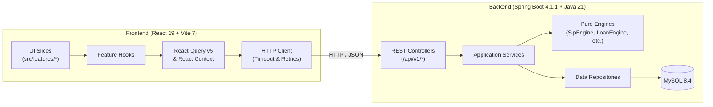

# InFinance — Personal Finance & Wealth Architecture for India

[](https://infinance-home.netlify.app/)
[](https://openjdk.org/projects/jdk/21/)
[](https://spring.io/projects/spring-boot)
[](https://react.dev/)
[](https://vitejs.dev/)
[](docs/ARCHITECTURE.md)

> A modern, trustworthy personal finance planning platform engineered for India (INR · ₹). Built with clean architecture principles, high-precision deterministic engines, and a responsive modern web experience.

---

## Architecture Overview



For an in-depth breakdown of architectural layering, domain design, and data flows, see [docs/ARCHITECTURE.md](docs/ARCHITECTURE.md).

---

## Repository Layout

```
Investment-Calculator/
├── backend/                       # Spring Boot 4.1.1 + Java 21 Application
│   ├── src/main/java/com/infinance/
│   │   ├── investing/             # SIP and lumpsum calculation engines
│   │   ├── loan/                  # EMI, prepayment, balance transfer, floating rate
│   │   ├── fixedincome/           # FD, RD, PPF, EPF, NPS, SSY calculators
│   │   ├── mutualfund/            # SWP, CAGR, XIRR engines
│   │   ├── tax/                   # Income tax FY 2024–25 (Old vs New Regime)
│   │   ├── taxoptimizer/          # Deduction optimization engine (80C, 80D, etc.)
│   │   ├── retirement/            # Retirement corpus & inflation annuity engine
│   │   ├── simulation/            # Monte Carlo multi-trial market simulator
│   │   ├── sensitivity/           # Multi-variable parameter stress tester
│   │   ├── healthscore/           # 100-point financial health diagnostic
│   │   ├── goals/                 # Multi-goal priority planning engine
│   │   ├── networth/              # Balance sheet asset/liability engine
│   │   ├── metals/                # Live gold, silver & platinum rates
│   │   ├── queries/               # Personal finance queries submission, rate limiting & owner contact
│   │   ├── reports/               # PDF and Excel export services
│   │   ├── auth/                  # JWT authentication, user accounts, saved scenarios
│   │   ├── configengine/          # Database-backed macro-economic assumptions
│   │   └── common/                # Security, CORS, RFC 7807 exceptions, math utils
│   └── src/main/resources/
│       ├── application.yml        # Base configuration
│       ├── application-dev.yml    # Development profile
│       ├── application-prod.yml   # Production profile
│       └── db/migration/          # Flyway schema migrations (V1..V7)
│
├── frontend/                      # Canonical Frontend (React 19 + Vite 7)
│   ├── src/
│   │   ├── app/                   # AppShell, ErrorBoundary, global providers
│   │   ├── features/              # Modular domain feature slices
│   │   │   ├── auth/              # Login, register, profile, protected routes
│   │   │   ├── fixed-income/      # Fixed income forms & hooks
│   │   │   ├── glossary/          # Financial dictionary terms
│   │   │   ├── goals/             # Goals planner
│   │   │   ├── health-score/      # Health score audit
│   │   │   ├── home/              # Landing hero, stats, live rates
│   │   │   ├── learn/             # Learn Hub articles & markdown reader
│   │   │   ├── loans/             # Loan forms & amortization charts
│   │   │   ├── metals/            # Precious metal market widget
│   │   │   ├── mutual-funds/      # SWP, CAGR, XIRR tools
│   │   │   ├── net-worth/         # Net worth calculator
│   │   │   ├── planning/          # Financial planning roadmap
│   │   │   ├── queries/           # Ask a Finance Query page, form & owner contact
│   │   │   ├── retirement/        # Retirement & Monte Carlo forms
│   │   │   ├── sip/               # SIP & lumpsum calculators
│   │   │   └── tax/               # Tax comparison & optimizer
│   │   ├── shared/                # Shared UI, API client, formatters, hooks
│   │   └── styles/                # Design system CSS tokens & animations
│   ├── e2e/                       # Playwright test specs
│   ├── package.json
│   ├── vite.config.js
│   └── eslint.config.js
│
├── docs/                          # Architecture, API spec, ADRs, cleanup audit
├── deploy/                        # Dockerfiles, docker-compose, Kubernetes manifests
└── README.md
```

---

## Quick Start

### 1. Prerequisites
- **Java 21+** and **Maven 3.9+**
- **Node.js 20+** and **npm 10+**
- **Docker** and **Docker Compose** (optional, for containerized run)

### 2. Running Locally

#### Backend (Spring Boot)
```bash
cd backend
mvn spring-boot:run
```
The backend starts on `http://localhost:8080`.
- **Interactive Swagger UI:** [http://localhost:8080/swagger-ui.html](http://localhost:8080/swagger-ui.html)
- **Actuator Health:** [http://localhost:8080/actuator/health](http://localhost:8080/actuator/health)

#### Frontend (React + Vite)
```bash
cd frontend
npm install
npm run dev
```
The frontend dev server starts on `http://localhost:5173`.

---

## Running with Docker & Kubernetes

### Docker Compose
Run the entire stack (MySQL 8.4, Spring Boot Backend, and Nginx-backed Vite Frontend) with a single command:
```bash
docker-compose up --build
```
- Frontend: `http://localhost:3000`
- Backend API: `http://localhost:8080`
- MySQL: `localhost:3306`

### Kubernetes
Kubernetes manifests are located under `deploy/k8s/`:
```bash
kubectl apply -f deploy/k8s/namespace.yaml
kubectl apply -f deploy/k8s/secrets.yaml
kubectl apply -f deploy/k8s/backend-deployment.yaml
kubectl apply -f deploy/k8s/frontend-deployment.yaml
kubectl apply -f deploy/k8s/ingress.yaml
```

---

## Environment Variables

### Backend Configuration

| Variable | Default (Dev) | Description |
| :--- | :--- | :--- |
| `SPRING_PROFILES_ACTIVE` | `dev` | Active Spring profile (`dev` or `prod`) |
| `SPRING_DATASOURCE_URL` | `jdbc:mysql://localhost:3306/infinance` | MySQL JDBC connection URL |
| `SPRING_DATASOURCE_USERNAME` | `infinance` | Database username |
| `SPRING_DATASOURCE_PASSWORD` | `infinance` | Database password |
| `JWT_SECRET` | *(dev fallback)* | Base64-encoded HMAC secret (required in prod) |
| `CORS_ALLOWED_ORIGINS` | `http://localhost:5173,...` | Comma-separated list of allowed frontend origins |
| `METALS_DEV_API_KEY` | *(empty)* | Optional API key for live metal rates |
| `INFINANCE_OWNER_NAME` | `Aniruddha Mondal` | Site owner display name |
| `INFINANCE_OWNER_WHATSAPP` | `+91 8013292565` | Direct WhatsApp contact number of owner (used for wa.me links) |
| `INFINANCE_OWNER_EMAIL` | `aniruddha0266@gmail.com` | Direct contact email address of owner |
| `INFINANCE_TEAM_n_*` | *(built-in defaults in yml)* | Team members configuration (index 0 = founder, index 1 = co-founder). All bios and roles have built-in defaults; numbers are never rendered as visible text. |
| `INFINANCE_QUERIES_NOTIFY_ENABLED` | `false` | Enable email notifications on query submission |
| `INFINANCE_QUERIES_RECIPIENT_EMAIL` | `aniruddha0266@gmail.com` | Recipient email address for query notifications |

### Frontend Configuration

| Variable | Default | Description |
| :--- | :--- | :--- |
| `VITE_API_BASE_URL` | `http://localhost:8080` | URL of the backend REST API |
| `VITE_METALS_API_ENABLED` | `true` | Feature flag to enable/disable metal price polling |
| `VITE_OWNER_NAME` | `Aniruddha Mondal` | Fallback display name of site owner |
| `VITE_OWNER_WHATSAPP` | `+91 8013292565` | Fallback direct WhatsApp contact number (for wa.me links) |
| `VITE_OWNER_EMAIL` | `aniruddha0266@gmail.com` | Fallback direct contact email address |
| `VITE_TEAM_n_*` | *(built-in defaults in owner.js)* | Fallback team members configuration. All bios and roles have built-in defaults; buttons display clean "Chat on WhatsApp" labels without visible numbers. |

---

## Scripts & Testing Reference

### Backend Tests
```bash
cd backend
mvn clean verify         # Full build, static analysis, unit & integration tests
mvn test                 # Run test suite
```

### Frontend Checks & Tests
```bash
cd frontend
npm run lint             # ESLint 9 verification
npm run format:check     # Prettier code style check
npm run format           # Auto-format all frontend source files
npm test                 # Run Vitest unit tests
npm run build            # Production Vite bundle build
npm run test:e2e         # Run Playwright end-to-end integration tests
```

---

## Documentation Index

- [Architecture Reference](docs/ARCHITECTURE.md)
- [REST API Reference](docs/API.md)
- [Contributing & Calculator Guide](docs/CONTRIBUTING.md)
- [State Management ADR](docs/adr/0001-state-management.md)
- [Architectural Changes & Non-Breaking Verification](docs/CHANGES.md)
- [Baseline Audit](docs/AUDIT.md)

---

## License

This project is licensed under the MIT License.
