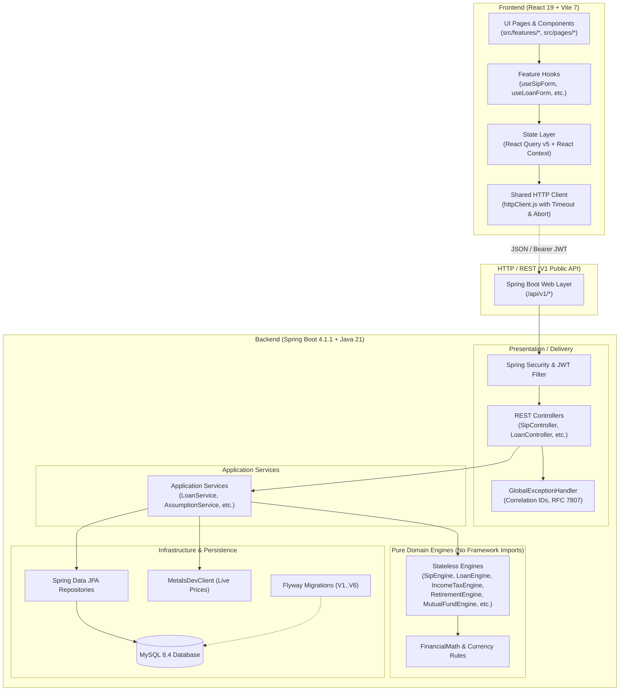

# InFinance Clean Architecture Specification

> Comprehensive architectural reference for InFinance (Spring Boot 4 / Java 21 backend and React 19 / Vite 7 frontend).

---

## 1. Architectural Principles

InFinance adheres to **Clean Architecture** and **Hexagonal (Ports & Adapters)** principles. The primary objectives are:

1. **Independent of Frameworks:** Core financial mathematics (SIP, EMI, compound interest, tax slabs, inflation annuities) reside in pure Java engines with zero framework dependencies (`org.springframework.*` is strictly forbidden in engine packages).
2. **Determinism and Financial Precision:** All currency calculations use `java.math.BigDecimal` with explicit scale and rounding modes (`RoundingMode.HALF_UP` / `MathContext.DECIMAL128`), preventing floating-point precision loss.
3. **Screaming Feature Organization:** Both backend and frontend organize code by business domain/feature rather than technical layer alone.
4. **Explicit Boundaries & Contracts:** Strict DTO boundaries isolate external REST APIs from internal calculation models. Route paths are governed by centralized constants (`ApiConstants`), and errors follow RFC 7807 problem details with correlation IDs.

---

## 2. System Architecture Diagram



---

## 3. Backend Architecture

### 3.1 Layering Model

The backend is partitioned into four distinct layers:

| Layer | Packages | Responsibility | Dependencies |
| :--- | :--- | :--- | :--- |
| **Presentation** | `com.infinance.*.controller` | Accepts HTTP requests, validates input DTOs, returns HTTP responses with OpenAPI annotations. | Application Services, DTOs, `ApiConstants` |
| **Application** | `com.infinance.*.service` | Coordinates business use cases, orchestrates transactions, enriches results with assumptions. | Domain Engines, Repositories, External Clients |
| **Domain (Engines)** | `com.infinance.*.engine` | Pure mathematical financial calculations (compound interest, tax slabs, XIRR). | Java Standard Library (`BigDecimal`, `LocalDate`) |
| **Infrastructure** | `com.infinance.common.*`, `configengine` | Security, persistence, external API integrations, configuration properties, error handling. | Spring Boot, JPA, Flyway, Jackson |

### 3.2 Pure Domain Engines
Every financial engine is implemented as a `public final class` with private constructors, static calculation methods, and record-based return types:
- **`SipEngine`:** Computes future values for standard and step-up SIPs using annuity-due compounding, pessimistic/optimistic scenarios, and yearly progression.
- **`LumpsumEngine` / `LumpsumCalculationEngine`:** Future value compounding `FV = P * (1 + r)^n` with yearly trajectories.
- **`LoanEngine`:** Amortization schedules, EMI (`P * r * (1+r)^n / ((1+r)^n - 1)`), prepayments, balance transfers, and floating rate sensitivity.
- **`IncomeTaxEngine`:** Indian tax computations across Old vs New Regimes for FY 2024–25 (Assessment Year 2025–26), including Section 87A rebate, standard deduction, and 4% Health & Education cess.
- **`RetirementEngine`:** Inflation-indexed annuities, retirement corpus requirements, shortfall gaps, and what-if retirement simulations.
- **`MutualFundEngine`:** Systematic Withdrawal Plans (SWP), Compound Annual Growth Rate (CAGR), and Extended Internal Rate of Return (XIRR) via Newton-Raphson approximation.
- **`MonteCarloEngine` & `SensitivityEngine`:** Stochastic multi-trial simulations and parameter stress-testing.

### 3.3 Universal Exception Handling
All controller exceptions are trapped by `GlobalExceptionHandler`:
- Emits RFC 7807 compliant problem details (`application/problem+json`).
- Automatically generates a unique tracing `correlationId` (UUID) attached to both the JSON body and the `X-Correlation-Id` HTTP response header.
- Distinguishes between client errors (`InvalidFinancialInputException`, `MethodArgumentNotValidException`) and internal system errors (`500 Internal Server Error`).

---

## 4. Frontend Architecture

### 4.1 Monorepo Layout
The frontend resides exclusively in `frontend/`, completely decoupled from the root build tooling.

```
frontend/
├── src/
│   ├── app/                     # Application shell, routing, error boundaries, providers
│   │   ├── AppShell.jsx
│   │   ├── ErrorBoundary.jsx
│   │   └── providers.jsx
│   ├── features/                # Feature slices (by domain)
│   │   ├── auth/                # Login, registration, profile, protected routes
│   │   ├── fixed-income/        # FD, RD, PPF, EPF, NPS, SSY forms & hooks
│   │   ├── glossary/            # Financial term definitions & search
│   │   ├── goals/               # Multi-goal education, marriage, home planner
│   │   ├── health-score/        # Personal financial health audit
│   │   ├── home/                # Landing hero, stats, quick SIP estimator
│   │   ├── learn/               # Learn Hub articles, reading badges, markdown viewer
│   │   ├── loans/               # Home/Personal loan EMI, prepayment, balance transfer
│   │   ├── metals/              # Live Gold/Silver prices widget & React Query hook
│   │   ├── mutual-funds/        # SWP, CAGR, XIRR calculators
│   │   ├── net-worth/           # Asset and liability tracking
│   │   ├── planning/            # Comprehensive financial roadmap
│   │   ├── retirement/          # Retirement corpus & Monte Carlo simulation
│   │   ├── sip/                 # SIP, Step-Up SIP, and Lumpsum calculators
│   │   └── tax/                 # Income tax calculator & deduction optimizer
│   ├── shared/                  # Reusable shared infrastructure
│   │   ├── api/                 # httpClient.js, endpoints.js, typed ApiError
│   │   ├── components/ui/       # Design system widgets (MoneyField, ProjectionChart, etc.)
│   │   ├── config/              # Centralized environment runtime configuration (env.js)
│   │   ├── hooks/               # useCalculatorMutation, useTheme, useScrollReveal
│   │   └── lib/                 # format.js (en-IN), validators.js, queryClient.js
│   ├── styles/                  # Modular design system CSS (index, animations, components)
│   ├── context/                 # AuthContext, ToastContext
│   └── i18n.js                  # Internationalization dictionary
├── e2e/                         # Playwright end-to-end integration tests
├── public/                      # Static assets, favicon, web manifest
├── vite.config.js               # Vite 7 build configuration
├── playwright.config.js         # Playwright test configuration
└── eslint.config.js             # Flat ESLint 9 configuration
```

### 4.2 State Management Pattern
- **Server State (`@tanstack/react-query` v5):** All remote data fetching (live metals, educational articles, calculator mutations) is handled via React Query. Provides declarative caching, automatic deduplication, and retry logic.
- **Client UI State (React Context):** Ephemeral UI state (active theme, toast alerts, session auth tokens) uses lightweight native React Contexts.
- See [ADR 0001: State Management](adr/0001-state-management.md) for full context and trade-offs.

---

## 5. Security & Configuration Architecture

### 5.1 Environment Profiles
The backend operates under two primary Spring profiles:
- **`dev` (Default):** Runs against local H2/MySQL with developer-friendly defaults.
- **`prod`:** Enforces strict validation via `ProductionConfigurationValidator`. Startup fails fast if:
  - `JWT_SECRET` is missing, blank, or matches the default development secret.
  - Database credentials use insecure default placeholders.
  - Actuator endpoints expose full stack traces publicly.

### 5.2 Frontend Environment Centralization
All `import.meta.env` access is routed through `src/shared/config/env.js`. It validates variables at build/runtime and falls back to safe defaults:
- `VITE_API_BASE_URL`: Base URL for the Spring Boot backend (`http://localhost:8080` in dev).
- `VITE_METALS_API_ENABLED`: Feature flag toggling live precious metals polling.
