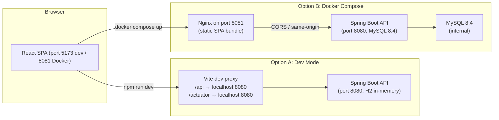

# Getting Started with InFinance

> Verified against: `pom.xml`, `application*.yml`, `application-assumptions.yml`, `vite.config.js`, `package.json`, `deploy/docker-compose.yml`, `deploy/docker/*`, `deploy/env/.env.example`, `frontend/.env.*`, `router.jsx`, `i18n.js`, `netlify.toml`. Commands were executed and confirmed locally.

---

## Table of Contents

1. [Overview](#1-overview)
2. [Prerequisites](#2-prerequisites)
3. [Run Locally — Option A: Dev Mode (Recommended)](#3-run-locally--option-a-dev-mode-recommended)
4. [Run Locally — Option B: Docker Compose](#4-run-locally--option-b-docker-compose)
5. [Configuration Reference](#5-configuration-reference)
6. [Running the Tests](#6-running-the-tests)
7. [Using the Application](#7-using-the-application)
8. [Troubleshooting](#8-troubleshooting)
9. [Where to Go Next](#9-where-to-go-next)

---

## 1. Overview

InFinance is a personal-finance planning tool for India (INR). It combines a **Spring Boot 4.1.1 / Java 21** backend that applies Indian-regulation financial formulas (SIP, EMI, income tax slabs, PPF, NPS, retirement corpus, SWP, XIRR, Monte Carlo) with a **React 19 / Vite 7** frontend that renders results with Indian number formatting (lakh/crore), three-language support, and dark/light theming.

**Live site:** <https://infinance-home.netlify.app/>

> **Live site limitation:** The Netlify deployment serves only the static frontend SPA. The `VITE_API_BASE_URL` build variable on Netlify's dashboard is **not publicly configured**, so calculator calls that POST to `/api/v1/*` will fail unless the deployer sets that variable to a live backend URL. Use **local dev mode** (Option A below) for full functionality.



---

## 2. Prerequisites

| Tool | Minimum Version | Check |
| :--- | :--- | :--- |
| JDK (Eclipse Temurin or equivalent) | 21 | `java -version` |
| Maven | 3.9+ | `mvn --version` |
| Node.js | 20+ | `node --version` |
| npm | 10+ | `npm --version` |
| Docker + Docker Compose | Any recent | `docker --version && docker compose version` |
| Git | Any recent | `git --version` |

**Quick setup check — copy and run all at once:**

```bash
java -version && mvn --version && node --version && npm --version && git --version
```

Expected output lines include `openjdk version "21"`, `Apache Maven 3.9.x`, `v20.x.x` (or higher), and `10.x.x` (or higher).

---

## 3. Run Locally — Option A: Dev Mode (Recommended)

This mode gives you:
- In-memory H2 database (auto-reset on restart; no MySQL required)
- Flyway migrations that auto-seed income tax slabs, government scheme rates, macro-economic assumptions, the Learn Hub articles, and the financial glossary
- Live precious-metal prices attempt the real `metals.dev` API but **serve stale/cached data gracefully** when no API key is present — the metals widget will show prices with a `STALE` badge rather than failing
- Hot-reload for both backend (Spring Boot DevTools) and frontend (Vite HMR)

### Step 1 — Clone the Repo

```bash
git clone https://github.com/<your-org>/Investment-Calculator.git
cd Investment-Calculator
```

### Step 2 — Start the Backend

Open **Terminal 1** and run:

```bash
cd backend
mvn spring-boot:run
```

The backend uses the `dev` Spring profile by default (`spring.profiles.default: dev` in `application.yml`). No environment variables are required for dev mode.

**It started correctly when you see:**

```
Started InFinanceCalculatorApplication in ~8-12 seconds
```

**Confirm it's healthy:**

```bash
# bash
curl -s http://localhost:8080/actuator/health | python3 -m json.tool

# PowerShell
Invoke-RestMethod http://localhost:8080/actuator/health | ConvertTo-Json
```

Expected output: `"status": "UP"` with `liveness` and `readiness` both `UP`.

**Other dev-mode endpoints:**

| URL | What it shows |
| :--- | :--- |
| `http://localhost:8080/swagger-ui.html` | Interactive Swagger UI (try any endpoint) |
| `http://localhost:8080/v3/api-docs` | Full OpenAPI 3.1 JSON spec |
| `http://localhost:8080/v3/api-docs/public` | Public calculators spec group |
| `http://localhost:8080/v3/api-docs/admin` | Admin endpoints spec group |
| `http://localhost:8080/h2-console` | H2 in-memory SQL console (JDBC URL: `jdbc:h2:mem:infinance_dev`) |

### Step 3 — Start the Frontend

Open **Terminal 2** and run:

```bash
cd frontend
npm install        # first time only
npm run dev
```

The Vite dev server starts on `http://localhost:5173`.

**How the API proxy works:**  
`vite.config.js` forwards all requests whose path starts with `/api` or `/actuator` to `VITE_BACKEND_URL` (defaults to `http://localhost:8080`). Because `VITE_API_BASE_URL` is left **blank** in `.env.development`, the frontend's `httpClient.js` uses relative paths like `/api/v1/investing/sip/calculate`. These relative paths hit Vite's built-in proxy, which forwards them to port 8080. You do **not** need to touch any `.env` file for local dev.

Only set `VITE_BACKEND_URL` if your backend runs on a non-default port or host:

```bash
# bash
VITE_BACKEND_URL=http://localhost:9090 npm run dev

# PowerShell
$env:VITE_BACKEND_URL="http://localhost:9090"; npm run dev
```

### Step 4 — Smoke Test (First Calculation)

1. Open <http://localhost:5173/>
2. Click **SIP Planner** in the navigation bar
3. Enter: Monthly investment **₹5,000** · Tenure **10 years** · Expected return **12%**
4. Click **Calculate**
5. Expected result: a **Projected SIP corpus** card showing the total corpus, invested amount, and estimated returns, plus a **Yearly SIP growth** bar chart

The API status dot in the header turns **green** when the first request succeeds.

---

## 4. Run Locally — Option B: Docker Compose

This mode runs MySQL 8.4 instead of H2. All three services (MySQL, Spring Boot backend, Nginx-served frontend) start in the correct dependency order.

### Step 1 — Copy and Edit the Env Template

```bash
# bash
cp deploy/env/.env.example deploy/.env

# PowerShell
Copy-Item deploy\env\.env.example deploy\.env
```

Edit `deploy/.env` and replace every placeholder value:

```ini
MYSQL_USER=infinance
MYSQL_PASSWORD=<a-real-local-db-password>
MYSQL_ROOT_PASSWORD=<a-real-local-root-password>
INFINANCE_JWT_SECRET=<at-least-32-random-chars>
INFINANCE_ADMIN_USERNAME=admin
INFINANCE_ADMIN_PASSWORD=<your-admin-password>
APP_CORS_ALLOWED_ORIGINS=http://localhost:8081
INFINANCE_METALS_API_KEY=           # leave blank for stale data; or add key from metals.dev
```

### Step 2 — Build and Start

```bash
cd deploy
docker compose up --build
```

The first build downloads base images and compiles the JAR — expect 3–5 minutes. Subsequent starts are fast.

**Ports after startup:**

| Service | Host URL | Notes |
| :--- | :--- | :--- |
| Frontend (Nginx) | `http://localhost:8081` | Full SPA |
| Backend API | `http://localhost:8080` | REST + Swagger |
| MySQL | `localhost:3306` | Internal only; not exposed to browser |

### Step 3 — Stop and Clean Up

```bash
# Stop containers but keep the database volume
docker compose down

# Stop AND delete the MySQL data volume (resets the database)
docker compose down -v
```

### Kubernetes (Pointer Only)

Kubernetes manifests live in `deploy/k8s/`. They include a `namespace.yaml`, a `secret.example.yaml` you must copy and populate, and separate `Deployment`/`Service` YAML files for MySQL, the backend, and the frontend. Steps:

1. `kubectl apply -f deploy/k8s/namespace.yaml`
2. Copy `deploy/k8s/secret.example.yaml` → `deploy/k8s/secret.yaml`; populate base64-encoded values; apply with `kubectl apply -f deploy/k8s/secret.yaml`
3. Edit image references in `deploy/k8s/backend.yaml` and `deploy/k8s/frontend.yaml` to point to your registry
4. `kubectl apply -k deploy/k8s/` (uses `kustomization.yaml`)

This is a pointer only; refer to the Kubernetes files directly for full detail.

---

## 5. Configuration Reference

> **Never use these defaults outside local dev:**
> `INFINANCE_JWT_SECRET` defaults to `change-this-development-secret-key-at-least-32-bytes`; `INFINANCE_ADMIN_PASSWORD` defaults to `change-me`; `INFINANCE_ENCRYPTION_SECRET` defaults to `development-only-change-me`. These values are in `application-dev.yml` and `application-assumptions.yml`. The `ProductionConfigurationValidator` (active on the `prod` profile) will refuse to start if any of these defaults are detected.

### Backend Variables

| Variable | Required in prod? | Default (dev) | Purpose |
| :--- | :---: | :--- | :--- |
| `INFINANCE_JWT_SECRET` | ✅ | `change-this-development-secret-key...` | HMAC secret for JWT signing. Min 32 bytes. |
| `INFINANCE_JWT_EXPIRATION` | No | `86400` (1 day in seconds) | Token lifetime in seconds |
| `INFINANCE_ENCRYPTION_SECRET` | ✅ | `development-only-change-me` | AES key for encrypting saved scenarios at rest |
| `INFINANCE_ADMIN_USERNAME` | No | `admin` | Bootstrap admin account username |
| `INFINANCE_ADMIN_PASSWORD` | ✅ | `change-me` | Bootstrap admin account password |
| `SPRING_DATASOURCE_URL` | ✅ (prod) | H2 in-memory (dev) | JDBC URL for MySQL in prod |
| `SPRING_DATASOURCE_USERNAME` | ✅ (prod) | `sa` (H2) | Database username |
| `SPRING_DATASOURCE_PASSWORD` | ✅ (prod) | *(blank)* (H2) | Database password |
| `SPRING_PROFILES_ACTIVE` | Recommended | `dev` (by default) | Set to `prod` for production |
| `APP_CORS_ALLOWED_ORIGINS` | ✅ (prod) | `http://localhost:5173,...` | Comma-separated list of allowed frontend origins |
| `INFINANCE_METALS_API_KEY` | No | *(blank)* | API key from [metals.dev](https://metals.dev) for live gold/silver/platinum prices |
| `INFINANCE_METALS_PROVIDER` | No | `metals-dev` | Provider selection |
| `INFINANCE_METALS_BASE_URL` | No | `https://api.metals.dev` | Provider base URL |
| `INFINANCE_METALS_AUTHORITY` | No | `mcx` | Price authority (MCX reference) |
| `INFINANCE_METALS_BASE_CURRENCY` | No | `INR` | Currency for metal prices |
| `INFINANCE_METALS_UNIT` | No | `g` | Price unit (per gram) |
| `INFINANCE_AI_ENABLED` | No | `false` | Enable AI plain-language explanations |
| `ANTHROPIC_API_KEY` | If AI enabled | *(blank)* | Anthropic API key for Claude-based explanations |
| `INFINANCE_AI_MODEL` | No | `claude-3-5-haiku-latest` | Anthropic model to use |
| `INFINANCE_REFRESH_ENABLED` | No | `false` | Enable periodic data refresh from AMFI/RBI URLs |
| `INFINANCE_AMFI_URL` | If refresh enabled | *(blank)* | AMFI NAV data source URL |
| `NVD_API_KEY` | CI only | *(blank)* | NVD key for OWASP dependency-check scan in CI. Without it, the scan is skipped with a warning. |

### Frontend Variables

All `VITE_*` variables are embedded at **build time** into the JavaScript bundle. They are visible in client-side code.

| Variable | Required? | Default (dev) | Purpose |
| :--- | :---: | :--- | :--- |
| `VITE_API_BASE_URL` | No (local dev) | *(blank)* | Absolute backend URL. Leave blank in dev to use the Vite proxy. Set to `https://api.your-domain.com` in production. |
| `VITE_BACKEND_URL` | No | `http://localhost:8080` | Used by Vite's dev-server proxy only (not in the bundle). |
| `VITE_APP_ENV` | No | `development` | `development` / `staging` / `production` |
| `VITE_APP_VERSION` | No | `2.0.0` | Injected by CI from git tag |

---

## 6. Running the Tests

### Backend

```bash
cd backend

# Full suite with coverage gate (recommended, excludes OWASP scan locally)
mvn clean verify -Ddependency-check.skip=true

# Tests only (no clean; avoids file-lock issues on Windows if IDE is open)
mvn test
```

**Expected result:** `Tests run: 108, Failures: 0, Errors: 0, Skipped: 0`

Reports land at:
- Surefire test results: `backend/target/surefire-reports/`
- JaCoCo coverage: `backend/target/site/jacoco/index.html`

### Frontend

```bash
cd frontend

# 1. Lint and format checks
npm run lint           # ESLint 9 — 0 errors expected
npm run format:check   # Prettier — "All matched files use Prettier code style!"

# 2. Vitest unit tests
npm test               # 37 tests, 9 test files expected to pass

# 3. Production build (validates the bundle compiles correctly)
npm run build          # Expected: "built in ~8s", 0 errors

# 4. Playwright end-to-end tests
#    First time: install the browser binary
npx playwright install chromium

#    Then run (no backend needed — E2E tests mock all /api calls)
npm run test:e2e       # 18 tests expected to pass in ~40 seconds
```

Playwright uses `vite preview` (port 4173) to serve the production bundle. It mocks the backend, so **you do not need the backend running** for E2E tests.

**Report locations:**

| Report | Path |
| :--- | :--- |
| Playwright HTML report | `frontend/playwright-report/` |
| Playwright trace (on failure) | `frontend/test-results/` |
| Vitest output | Terminal only (no separate file) |

---

## 7. Using the Application

### Navigation Map

The sticky navbar at the top shows these items (verified from `AppShell.jsx` `NAV_ITEMS` and `router.jsx`):

| Nav Label | Route | What it does |
| :--- | :--- | :--- |
| **(logo / home)** | `/` | Landing page with hero, live metal prices widget, feature cards, and the Quick SIP Estimator slider |
| **Learn Hub** | `/learn` | Article listing with category filters and search. Click any card to read the full article. |
| **Roadmap** | `/roadmap` | Planned features and project status |
| **SIP Planner** | `/sip` | SIP & Step-Up calculator + Lumpsum (tabs within the page) |
| **Loan & EMI** | `/loan` | EMI calculator (the standalone form; extended loan suite via API) |
| **Fixed Income** | `/fixed` | FD / RD / PPF / EPF / NPS / SSY / Post Office (selector dropdown) |
| **Mutual Funds** | `/mutual` | SWP (Systematic Withdrawal Plan) calculator |
| **Tax & Planning** | `/planning` | Income tax, tax optimizer, retirement, Monte Carlo, financial health score, net worth, goals |
| **Glossary** | `/glossary` | Financial term definitions with search |
| **(account / sign in)** | `/login`, `/register`, `/account` | Authentication and saved scenarios |

Legacy redirect aliases exist for old routes (e.g. `/calculators/sip-calculator` → `/sip`).

### Header Controls

The top-right of the navbar has:
- **Language switcher** — cycles through **English**, **हिन्दी** (Hindi), **বাংলা** (Bengali)
- **Dark-mode toggle** — persists to `localStorage`
- **Sign In** / user avatar dropdown (when logged in) — links to Account page, logout

### Calculator Walkthroughs

---

#### SIP & Step-Up Planner (`/sip`)

1. Enter **Monthly investment** (e.g. ₹10,000; minimum ₹100)
2. Enter **Time horizon** (e.g. 15 years; range 1–50)
3. Enter **Expected return** (e.g. 12%; range 1–30%)
4. Optionally enter **Annual step-up %** (e.g. 10%; 0 = no step-up)
5. Select **Risk profile** (Low / Moderate / Aggressive)
6. Click **Calculate**

**Results show:**
- **Projected SIP corpus** card: total corpus, total invested, estimated returns
- **Yearly SIP growth** bar chart
- **Scenario comparison**: Pessimistic (return − 3%), Expected, and Optimistic (return + 3%) corpus values
- **Assumptions**: inflation rate, benchmark returns, disclaimer, and the current financial year (FY 2024–25)

> For a **Lumpsum** calculation, use the same page with step-up = 0 and a one-time contribution amount.

---

#### Loan & EMI Suite (`/loan`)

The main form calculates a standard EMI:

1. Enter **Loan principal** (e.g. ₹50,00,000; minimum ₹1,000)
2. Enter **Tenure** in years (e.g. 20 years; range 1–30)
3. Enter **Interest rate** (e.g. 8.5% p.a.; range 1–30%)
4. Click **Calculate EMI**

**Results show:**
- Monthly EMI, total interest, total payment
- **Remaining balance over time** chart (annual milestones)

The backend API also supports prepayment analysis (`/api/v1/loan/prepayment`), surplus comparison (`/api/v1/loan/surplus-compare`), balance transfer (`/api/v1/loan/balance-transfer`), and floating rate simulation (`/api/v1/loan/floating-rate`). These are currently API-only; use Swagger UI or the Bruno collection to explore them.

---

#### Fixed-Income Calculators (`/fixed`)

1. Select the **Scheme** from the dropdown:
   - Fixed Deposit (FD) · Recurring Deposit (RD) · Public Provident Fund (PPF) · Employee Provident Fund (EPF) · National Pension System (NPS) · Sukanya Samriddhi Yojana (SSY) · Post Office Time Deposit
2. Enter **Contribution** (lumpsum for FD/PPF/EPF; monthly for RD)
3. Enter **Tenure** (e.g. 15 years for PPF)
4. Enter **Your tax rate** (e.g. 30%)
5. Leave **Override rate** blank to use the official government/regulatory rate, or enter a custom rate
6. Click **Calculate**

**Results show:** Maturity value, total contribution, interest earned (or returns), with a note on the applied rate and its authoritative source.

> PPF, SSY, NPS, and EPF rates are seeded from `application-assumptions.yml` which is verified against official government sources — see `docs/project-details/rate-verification-2026-09-26.md`.

---

#### Mutual Fund Tools — SWP (`/mutual`)

1. Enter **Starting corpus** (e.g. ₹50,00,000)
2. Enter **Annual return** of the fund (e.g. 11%)
3. Enter **Monthly withdrawal** (e.g. ₹25,000)
4. Enter **Withdrawal period** in years (e.g. 20 years)
5. Enter **Annual increase in withdrawal** (e.g. 5% to keep pace with inflation)
6. Click **Calculate**

**Results show:** Remaining corpus at end, total withdrawn, and a yearly corpus-depletion chart. If the corpus hits ₹0 before the tenure ends, the chart shows the depletion year.

> CAGR and XIRR calculations are available via the API (`/api/v1/mutual-funds/cagr`, `/api/v1/mutual-funds/xirr`). Use Swagger UI to explore them directly.

---

#### Tax & Smart Planning (`/planning`)

This page has several independent sections:

**Income Tax & Optimizer**
1. In the Tax Optimizer section, enter your Section 80C contributions, 80D premiums, and NPS contributions
2. Click **Optimize** to see remaining deduction room and recommended investments
3. For a full Old vs New Regime comparison with slab breakdown, use the backend API directly at `POST /api/v1/tax/calculate` via Swagger UI

**Retirement Planning**
1. Enter current age, target retirement age, life expectancy
2. Enter current monthly expenses, inflation rate, post-retirement return
3. Enter current savings and monthly SIP
4. Click **Calculate**
5. Results: required corpus, projected corpus, shortfall/surplus, additional SIP needed, age trajectory chart

**Monte Carlo Simulation**
1. Default inputs: initial corpus ₹5,00,000, monthly contribution ₹25,000, 15-year horizon, 10% return, 12% volatility, 6% inflation
2. Click **Run Simulation** — backend runs 1,000 trials
3. Results: success probability (% of trials reaching the target corpus), P10/P50/P90 corpus percentiles

**Financial Health Score**
Enter income, expenses, debt, emergency fund, insurance, and investments to receive a 100-point score with component breakdown.

**Net Worth**
Enter assets (liquid, equity, real estate, gold, provident fund, other) and liabilities to see your net worth balance sheet.

**Goals Planner**
Enter multiple financial goals (home, education, marriage, emergency fund) with target amounts and years. The engine prioritizes and suggests monthly savings for each.

---

### Account Features

**Register:**
1. Click **Sign In** in the navbar → switch to the **Register** tab
2. Enter display name, email, and password (minimum 8 characters)
3. A password strength meter appears as you type

**Login / Logout:**
- Login stores the JWT in `sessionStorage` (cleared when the browser tab closes)
- Logout clears the token and redirects to home

**Saving Scenarios:**
- After any calculation, the Account page (`/account`) shows saved scenarios
- Scenarios are stored encrypted at rest using `INFINANCE_ENCRYPTION_SECRET`
- Registered users can compare saved scenarios side by side from the Account page

**Note:** After a backend restart in dev mode (H2 database reset), previously registered accounts are gone — re-register after each restart.

---

### Exports and Extras

| Feature | How to access |
| :--- | :--- |
| **PDF report** | `POST /api/v1/reports/pdf` (authenticated) via Swagger UI |
| **Excel export** | `POST /api/v1/reports/excel` (authenticated) via Swagger UI |
| **AI plain-language explanation** | Requires `INFINANCE_AI_ENABLED=true` and a valid `ANTHROPIC_API_KEY` |
| **Glossary tooltips** | `/glossary` — searchable financial term definitions |
| **Learn Hub articles** | `/learn` — 15+ seeded articles with category filters |
| **Live precious metal prices** | Home page widget — Gold (24K, 22K), Silver, Platinum in ₹/gram |
| **Onboarding wizard** | `/onboarding` — 5-question wizard generating calculator recommendations |

---

### Reading Results Correctly

- **Indian number formatting:** Amounts display as ₹1,00,000 (1 lakh), ₹10,00,000 (10 lakh), ₹1,00,00,000 (1 crore). The lakh/crore compact formatter (e.g. "₹1.00 Cr") is used for very large corpus values.
- **22K gold price:** Derived as `24K price × (22/24)`. It is an indicative purity calculation, **not** a local jeweller's retail price — GST, making charges, and retail margins are not included.
- **"Assumptions" section:** Every result card displays the macro-economic assumptions used (inflation rate, benchmark returns, financial year). These are authoritative values from the Ministry of Finance, EPFO, PFRDA, RBI, and AMFI, loaded from `application-assumptions.yml`.
- **Disclaimer:** All results are educational estimates, not investment, tax, or legal advice. Rates change — verify with official sources before making decisions. The disclaimer text appears at the bottom of every page.

---

## 8. Troubleshooting

| Symptom | Likely Cause | Fix |
| :--- | :--- | :--- |
| **Port 8080 already in use** | Another process is using the port | `lsof -i :8080` (Linux/Mac) or `netstat -ano \| findstr :8080` (Windows) to find the PID, then kill it |
| **Port 5173 already in use** | Another Vite server is running | Kill it, or run `npm run dev -- --port 5174` |
| **Port 8081 already in use** (Docker) | Another process occupies 8081 | Edit `ports:` in `deploy/docker-compose.yml` to use a different host port |
| **`Could not find artifact` or Maven download errors** | Network or Maven cache corruption | Run `mvn dependency:purge-local-repository -DreResolve=false` then retry |
| **Wrong JDK version (`UnsupportedClassVersionError`)** | JDK < 21 on PATH | Ensure `JAVA_HOME` points to JDK 21; check with `java -version` |
| **`Failed to parse module graph` or Vite startup error** | Node < 20 | Upgrade Node; use `nvm use 20` if nvm is installed |
| **Blank page / all API calls return 502 or network error** | Backend not started, or Vite proxy misconfigured | Start the backend first. Confirm `VITE_BACKEND_URL` in `.env.development` matches the backend port. |
| **CORS error in browser console** | `APP_CORS_ALLOWED_ORIGINS` does not include your frontend origin | Add the frontend origin (e.g. `http://localhost:5173`) to `app.cors.allowed-origins` in `application-dev.yml` or via the env var |
| **`API offline` dot in header; all calculators fail** | Backend not reachable from browser | Confirm backend is running on port 8080; check that the Vite proxy target (`VITE_BACKEND_URL`) is correct |
| **Metals widget shows `STALE` badge** | No API key set; last successful fetch has expired stale TTL | Normal behaviour without a key. Set `INFINANCE_METALS_API_KEY` from [metals.dev](https://metals.dev) to get live prices |
| **Metals widget shows `UNAVAILABLE`** | No cached data at all, and no API key | The widget degrades gracefully — calculators continue to work. Provide an API key or ignore it |
| **`401 Unauthorized` after backend restart** | H2 was wiped; JWT secret may have changed | Re-register your account. In dev, H2 resets on every restart. |
| **Docker build fails: `COPY backend/pom.xml` not found** | Run from wrong directory | Run `docker compose up --build` from **inside `deploy/`**, not the root |
| **Windows line-ending issues in shell scripts** | Git checked out files with CRLF | Run `git config core.autocrlf input` before cloning, or fix with `dos2unix <file>` |
| **`mvn clean` fails with file-locked error (Windows)** | VS Code / IntelliJ language server locks `target/classes/` | Run `mvn test` instead of `mvn clean verify`, or close the IDE's Java language server before cleaning |
| **Reset the local database (dev)** | H2 is in-memory, so simply restarting the backend resets it | Stop the backend (`Ctrl-C`) and restart with `mvn spring-boot:run`. For Docker/MySQL, run `docker compose down -v` then `docker compose up` |

---

## 9. Where to Go Next

| Resource | Location |
| :--- | :--- |
| **Architecture reference** | [docs/ARCHITECTURE.md](docs/ARCHITECTURE.md) |
| **Full REST API reference** | [docs/API.md](docs/API.md) |
| **Contributing & adding a calculator** | [docs/CONTRIBUTING.md](docs/CONTRIBUTING.md) |
| **State management ADR** | [docs/adr/0001-state-management.md](docs/adr/0001-state-management.md) |
| **Baseline audit** | [docs/AUDIT.md](docs/AUDIT.md) |
| **Change log** | [CHANGELOG.md](CHANGELOG.md) |
| **Interactive Swagger UI** | `http://localhost:8080/swagger-ui.html` (backend must be running) |
| **Bruno API collection** | `bruno/Investment-Calculator/` |
| **Postman collection** | `postman/` *(directory present but empty in current state)* |

---

## Appendix: README/Config Inconsistencies Found and Fixed

The following discrepancies were discovered during the verification process for this document:

| Location | Issue Found | Status |
| :--- | :--- | :--- |
| Root `README.md` (before refactor) | Listed `config_engine/` as the package name and `docker-compose.yml` at the root — neither is accurate. The package is `configengine` and docker-compose is at `deploy/docker-compose.yml`. | **Fixed** — README rewritten in Phase 8 |
| Root `README.md` — Docker section | Said `docker-compose up --build` from root works — there is no `docker-compose.yml` at the root; it is in `deploy/`. | **Fixed** in README; correctly documented above |
| `frontend/netlify.toml` (pre-Phase 6) | Had non-functional `:BACKEND_URL` proxy rewrite rules that would never match anything on Netlify. | **Fixed** in Phase 6 — file now correctly documents CORS-only architecture |
| `README.md` — Kubernetes section | Said manifests are in `k8s/` (root). They are actually in `deploy/k8s/`. | **Fixed** above and in README |
| Live site calculator functionality | `README.md` implied calculators worked on the live Netlify site. `VITE_API_BASE_URL` is not configured, so they do not reach any backend. | **Documented plainly** in Section 1 above |
| `MetalsDevDataProvider` | Named "dev provider" but actually makes real HTTP calls to `metals.dev` in dev profile — it is the production provider restricted to the dev profile. No dev stub exists. Behaviour: gracefully falls back to stale/cached data when the API key is absent. | **Documented accurately** in Section 3 and Section 8 |
